# 高蛋白松饼

约 14 分钟 · 1 份 · 每张 347.8 kcal · 蛋白质 32.9 g

## 配方表

<table class="cfe"><colgroup><col style="width:155px"><col style="width:96px"><col style="width:96px"><col style="width:88px"><col style="width:110px"><col style="width:96px"><col style="width:96px"></colgroup><tr><td colspan="1">鸡蛋 <b>1 个</b></td><td rowspan="3" colspan="1">搅匀 1 min</td><td rowspan="9" colspan="1">拌合 2 min</td><td rowspan="9" colspan="2">静置 7 min · 等待</td><td rowspan="10" colspan="1">煎 小火加盖 2 min</td><td rowspan="10" colspan="1">翻面 2 min</td></tr><tr><td colspan="1">脱脂希腊酸奶 <b>30 g</b></td></tr><tr><td colspan="1">全脂牛奶 <b>50 ml</b></td></tr><tr><td colspan="2">乳清蛋白粉 <b>25 g</b></td></tr><tr><td colspan="2">低筋面粉 <b>25 g</b></td></tr><tr><td colspan="2">阿洛酮糖 <b>10 g</b></td></tr><tr><td colspan="2">肉桂粉 <b>0.5 tsp</b></td></tr><tr><td colspan="2">泡打粉 <b>0.5 tsp</b></td></tr><tr><td colspan="2">盐 <b>1 撮</b></td></tr><tr><td colspan="4">含盐黄油 <b>5 g</b></td><td rowspan="1" colspan="1">热锅 3 min · 等待</td></tr></table>

## 时间线

```mermaid
gantt
dateFormat mm
axisFormat %M
todayMarker off
  搅匀 :wet, 00, 1m
  拌合 :mix, 01, 2m
  静置 :done, rest, 03, 7m
  热锅 :done, heat, 07, 3m
  煎 :fry, 10, 2m
  翻面 :flip, 12, 2m
```

## 营养成分

| 项目 | 每张 |
|---|---:|
| 热量（kcal） | 347.8 |
| 蛋白质（g） | 32.9 |
| 碳水（g） | 27.4 |
| 脂肪（g） | 11.2 |
| 膳食纤维（g） | 1.1 |
| 钠（mg） | 614.5 |
