# 高蛋白法式吐司

约 10 分钟 · 3 片 · 每片 200.5 kcal · 蛋白质 19.8 g

## 配方表

<table class="cfe"><colgroup><col style="width:155px"><col style="width:96px"><col style="width:101px"><col style="width:110px"><col style="width:110px"></colgroup><tr><td colspan="1">脱脂希腊酸奶 <b>50 g</b></td><td rowspan="4" colspan="1">搅匀 2 min</td><td rowspan="5" colspan="1">浸泡 两面 2 min · 等待</td><td rowspan="6" colspan="1">煎 3 min</td><td rowspan="6" colspan="1">翻面 3 min</td></tr><tr><td colspan="1">全脂牛奶 <b>50 ml</b></td></tr><tr><td colspan="1">鸡蛋 <b>3 个</b></td></tr><tr><td colspan="1">阿洛酮糖 <b>20 g</b></td></tr><tr><td colspan="2">高蛋白低碳面包 <b>3 片</b> 约 125 g</td></tr><tr><td colspan="2">含盐黄油 <b>10 g</b></td><td rowspan="1" colspan="1">热锅 中小火 化黄油 2 min · 等待</td></tr></table>

## 时间线

```mermaid
gantt
dateFormat mm
axisFormat %M
todayMarker off
  搅匀 :wet, 00, 2m
  浸泡 :done, soak, 02, 2m
  热锅 :done, heat, 02, 2m
  煎 :fry, 04, 3m
  翻面 :flip, 07, 3m
```

## 营养成分

| 项目 | 每片 | 整份（3片） |
|---|---:|---:|
| 热量（kcal） | 200.5 | 601.5 |
| 蛋白质（g） | 19.8 | 59.4 |
| 碳水（g） | 8.8 | 26.4 |
| 脂肪（g） | 8.2 | 24.6 |
| 膳食纤维（g） | 3.2 | 9.6 |
| 钠（mg） | 136.3 | 408.9 |
