# 乳清蛋白松饼(三大张)

约 22 分钟 · 3 张 · 每张 343.6 kcal · 蛋白质 33.5 g

## 配方表

<table class="cfe"><colgroup><col style="width:155px"><col style="width:96px"><col style="width:96px"><col style="width:88px"><col style="width:110px"><col style="width:176px"><col style="width:176px"></colgroup><tr><td colspan="1">乳清蛋白粉 <b>75 g</b></td><td rowspan="6" colspan="1">拌匀 1 min</td><td rowspan="9" colspan="1">拌合 无干粉即停 1 min</td><td rowspan="9" colspan="2">静置 7 min · 等待</td><td rowspan="10" colspan="1">煎 小火 加盖 逐张 2 分钟 6 min</td><td rowspan="10" colspan="1">翻面 逐张 2 分钟 6 min</td></tr><tr><td colspan="1">低筋面粉 <b>75 g</b></td></tr><tr><td colspan="1">阿洛酮糖 <b>20 g</b></td></tr><tr><td colspan="1">肉桂粉 <b>0.5 tsp</b></td></tr><tr><td colspan="1">泡打粉 <b>0.5 tsp</b></td></tr><tr><td colspan="1">盐 <b>1 撮</b></td></tr><tr><td colspan="1">鸡蛋 <b>3 个</b></td><td rowspan="3" colspan="1">搅匀 1 min</td></tr><tr><td colspan="1">脱脂希腊酸奶 <b>90 g</b></td></tr><tr><td colspan="1">全脂牛奶 <b>200 ml</b></td></tr><tr><td colspan="4">含盐黄油 <b>10 g</b></td><td rowspan="1" colspan="1">热锅 小火 抹黄油 3 min · 等待</td></tr></table>

## 时间线

```mermaid
gantt
dateFormat mm
axisFormat %M
todayMarker off
  拌匀 :dry, 00, 1m
  搅匀 :wet, 01, 1m
  拌合 :mix, 02, 1m
  静置 :done, rest, 03, 7m
  热锅 :done, heat, 07, 3m
  煎 :fry, 10, 6m
  翻面 :flip, 16, 6m
```

## 营养成分

| 项目 | 每张 | 整份（3张） |
|---|---:|---:|
| 热量（kcal） | 343.6 | 1030.8 |
| 蛋白质（g） | 33.5 | 100.5 |
| 碳水（g） | 27.1 | 81.3 |
| 脂肪（g） | 10.3 | 30.9 |
| 膳食纤维（g） | 0.7 | 2.1 |
| 钠（mg） | 388.0 | 1164.0 |
