# 乳清蛋白松饼

约 13 分钟 · 1 份 · 每份 315.0 kcal · 蛋白质 34.6 g

## 配方表

<table class="cfe"><tr><td colspan="1">乳清蛋白粉 <b>25 g</b></td><td rowspan="6" colspan="1">拌匀 1 min</td><td rowspan="9" colspan="1">翻拌至无干粉 1 min</td><td rowspan="9" colspan="1">静置 7 min · 等待</td><td rowspan="10" colspan="1">小火盖盖煎 2 min</td><td rowspan="10" colspan="1">翻面再煎 1 min</td></tr><tr><td colspan="1">面粉 <b>20 g</b></td></tr><tr><td colspan="1">阿洛酮糖 <b>10 g</b></td></tr><tr><td colspan="1">肉桂粉 <b>0.5 tsp</b></td></tr><tr><td colspan="1">泡打粉 <b>0.5 tsp</b></td></tr><tr><td colspan="1">盐 <b>1 撮</b></td></tr><tr><td colspan="1">鸡蛋 <b>1 个</b></td><td rowspan="3" colspan="1">打散 1 min</td></tr><tr><td colspan="1">无糖希腊酸奶 <b>55 g</b></td></tr><tr><td colspan="1">全脂牛奶 <b>25 ml</b></td></tr><tr><td colspan="3">含盐黄油 <b>3 g</b></td><td rowspan="1" colspan="1">小火热锅抹黄油 3 min · 等待</td></tr></table>

## 时间线

```mermaid
gantt
dateFormat mm
axisFormat %M
todayMarker off
  拌匀 :dry, 00, 1m
  打散 :wet, 01, 1m
  翻拌至无干粉 :mix, 02, 1m
  静置 :done, rest, 03, 7m
  小火热锅抹黄油 :done, heat, 07, 3m
  小火盖盖煎 :fry, 10, 2m
  翻面再煎 :flip, 12, 1m
```

## 营养成分

| 项目 | 每份 |
|---|---:|
| 热量（kcal） | 315.0 |
| 蛋白质（g） | 34.6 |
| 碳水（g） | 22.9 |
| 脂肪（g） | 8.6 |
| 膳食纤维（g） | 1.2 |
| 钠（mg） | 597.0 |
