# 番茄罗勒烤鸡腿一夜干

约 77 分钟（另需提前一天准备） · 2 份 · 每份 658.5 kcal · 蛋白质 37.3 g

## 配方表

<table class="cfe"><colgroup><col style="width:150px"><col style="width:320px"><col style="width:94px"><col style="width:89.41707308680967px"><col style="width:104.58292691319033px"><col style="width:66px"><col style="width:118px"></colgroup><tr><td colspan="1">鸡腿 <b>2 只</b> 共约 350 g 带骨</td><td rowspan="2" colspan="2">一夜干 擦干抹盐 冷藏风干 12 h</td><td rowspan="7" colspan="3">烤 鸡腿皮朝上放最上面 170°C 70 min</td><td rowspan="10" colspan="1">拌 挤出烤蒜压烂番茄 3 min</td></tr><tr><td colspan="1">盐 <b>7 g</b> 鸡重的 2%</td></tr><tr><td colspan="2">小番茄 <b>300 g</b></td><td rowspan="1" colspan="1">切半 3 min</td></tr><tr><td colspan="3">带皮蒜瓣 <b>8 瓣</b></td></tr><tr><td colspan="3">罗勒 <b>5 g</b></td></tr><tr><td colspan="3">橄榄油 <b>15 ml</b></td></tr><tr><td colspan="3">黑胡椒碎 <b>适量</b></td></tr><tr><td colspan="4">Cavatappi 意面 <b>150 g</b></td><td rowspan="1" colspan="2">煮 留半杯面水 10 min</td></tr><tr><td colspan="5">帕玛森干酪 <b>15 g</b></td><td rowspan="1" colspan="1">磨碎 1 min</td></tr><tr><td colspan="6">罗勒 <b>5 g</b></td></tr></table>

## 时间线

```mermaid
gantt
dateFormat HH:mm
axisFormat %H:%M
todayMarker off
  切半 :halve, 00:00, 3m
  烤 :done, roast, 00:03, 70m
  煮 :done, cook, 01:03, 10m
  磨碎 :grate, 01:13, 1m
  拌 :toss, 01:14, 3m
```

## 营养成分

| 项目 | 每份 | 整份（2份） |
|---|---:|---:|
| 热量（kcal） | 658.5 | 1317.0 |
| 蛋白质（g） | 37.3 | 74.6 |
| 碳水（g） | 66.5 | 133.0 |
| 脂肪（g） | 26.7 | 53.4 |
| 膳食纤维（g） | 4.7 | 9.4 |
| 钠（mg） | 1793.5 | 3587.0 |
